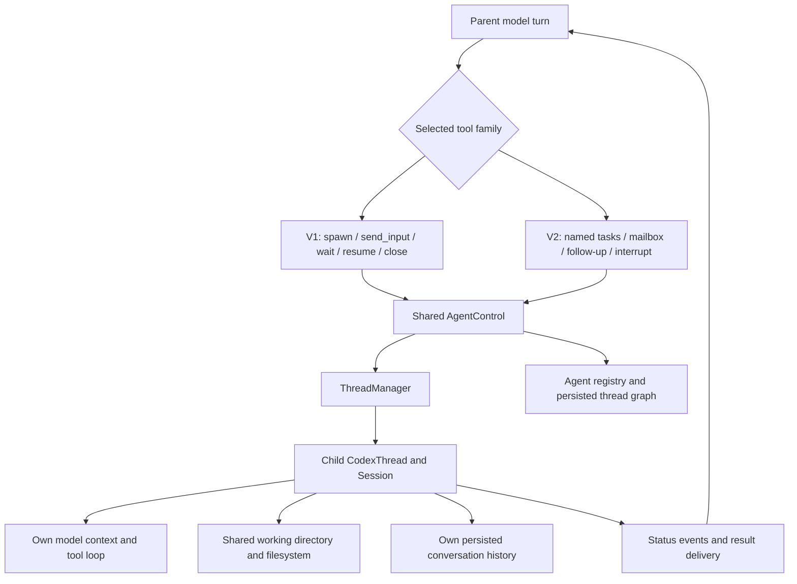

# Codex CLI subagents: shared runtime, v1, and v2

Researched 2026-09-05 against the public [openai/codex repository](https://github.com/openai/codex), pinned to commit [`3b2d9a69e62745d4e1ebfda84cfc6134c529b7c4`](https://github.com/openai/codex/commit/3b2d9a69e62745d4e1ebfda84cfc6134c529b7c4), committed 2026-09-04 at 22:11:14 UTC. This is a source snapshot of `main`, not a claim that every released binary or account uses these defaults. Findings come from reading implementation, schemas, existing tests, and selected GitHub history; no code was executed to validate runtime behavior and no tests were added.

## The important distinctions

There are **two collaboration implementations over a shared Codex runtime**. The actual `MultiAgentVersion` enum contains `Disabled`, `V1`, and `V2`. It does **not** contain `Base`. In these notes, “foundation” means the session/thread/configuration machinery underneath both versions. `multi_agents.rs` is the older v1 tool module; `multi_agents_common.rs` contains shared helpers; `multi_agents_v2.rs` is the newer tool module. A `base_instructions` field or a local variable named `base` is not another subagent backend. [Version enum](https://github.com/openai/codex/blob/3b2d9a69e62745d4e1ebfda84cfc6134c529b7c4/codex-rs/protocol/src/protocol.rs#L2997-L3004), [handler modules](https://github.com/openai/codex/blob/3b2d9a69e62745d4e1ebfda84cfc6134c529b7c4/codex-rs/core/src/tools/handlers/mod.rs#L13-L16).

| Aspect | V1 | V2 |
| --- | --- | --- |
| Mental model | Parent manages child sessions | Agents communicate within a named task tree |
| Default namespace at this SHA | `multi_agent_v1` | `collaboration` |
| Tools | `spawn_agent`, `send_input`, `wait_agent`, `resume_agent`, `close_agent` | `spawn_agent`, `send_message`, `followup_task`, optional `wait_agent`, `interrupt_agent`, `list_agents` |
| Addressing | Thread/agent ID | Thread ID or canonical/relative task path |
| New child context default | Fresh context; opt into `fork_context` | `fork_turns = "all"`; also supports `"none"` or a positive turn count |
| Ordinary message vs new assignment | Combined in `send_input` | Separate mailbox message and turn-triggering follow-up |
| Wait contract | Read final status from specified targets | Wait for an unread mailbox update, user steering, or timeout |
| Nesting | `max_depth`, default 1 | V1 depth limit ignored; model support still gates child delegation tools |
| Unconfigured capacity | 6 spawned children, excluding root | 4 total slots including root; separate execution/residency accounting |
| End-of-work management | Explicit close releases an open-child slot; resume can restore | Interrupt ends a turn; idle runtimes can be evicted and reloaded |

Tool registration and depth/model gates are explicit in [spec_plan.rs](https://github.com/openai/codex/blob/3b2d9a69e62745d4e1ebfda84cfc6134c529b7c4/codex-rs/core/src/tools/spec_plan.rs#L644-L695) and [registration branches](https://github.com/openai/codex/blob/3b2d9a69e62745d4e1ebfda84cfc6134c529b7c4/codex-rs/core/src/tools/spec_plan.rs#L1284-L1369). Capacity defaults are in [config constants](https://github.com/openai/codex/blob/3b2d9a69e62745d4e1ebfda84cfc6134c529b7c4/codex-rs/core/src/config/mod.rs#L232-L242). Detailed behavior and caveats are documented below.

The diagram is a synthesis of the source paths cited in the runtime sections below. A spawned agent is another managed Codex session, not automatically another Git checkout, a new container, or a separately launched CLI binary.

## Which implementation gets selected

For a new session without inherited or persisted runtime metadata, the effective choice is resolved from configuration and model metadata, in this order:

1. An enabled `features.multi_agent_v2` forces V2.
2. Otherwise, `agents.enabled = false` disables collaboration tools.
3. Otherwise, a model's `multi_agent_version` takes precedence when provided.
4. Otherwise, the `multi_agent` feature chooses V1 when enabled, or Disabled when not.

The first step intentionally takes precedence even over `agents.enabled = false`; the configuration type documents this. At this SHA, both feature entries are marked Stable, but their fallback defaults differ: `multi_agent = true`, `multi_agent_v2 = false`. Therefore “the v2 feature defaults off” does not establish that a particular model/session runs V1. [Resolution code](https://github.com/openai/codex/blob/3b2d9a69e62745d4e1ebfda84cfc6134c529b7c4/codex-rs/core/src/config/mod.rs#L1539-L1582), [feature definitions](https://github.com/openai/codex/blob/3b2d9a69e62745d4e1ebfda84cfc6134c529b7c4/codex-rs/features/src/lib.rs#L1251-L1267), [agents configuration](https://github.com/openai/codex/blob/3b2d9a69e62745d4e1ebfda84cfc6134c529b7c4/codex-rs/config/src/config_toml.rs#L680-L702).

Existing sessions add a persistence rule: a `OnceLock` retains their selected runtime, so changing the model does not silently replace the collaboration tool family. Resumed/forked history supplies recorded runtime metadata; legacy history without it falls back to V1. An inherited Disabled runtime is specially preserved when initializing history. Explicit configuration overrides still pass through the effective resolver. [History resolution](https://github.com/openai/codex/blob/3b2d9a69e62745d4e1ebfda84cfc6134c529b7c4/codex-rs/core/src/session/mod.rs#L466-L482), [sticky runtime resolution](https://github.com/openai/codex/blob/3b2d9a69e62745d4e1ebfda84cfc6134c529b7c4/codex-rs/core/src/session/mod.rs#L3857-L3880).

The bundled model catalog in this snapshot selects V2 for GPT-6 Astra and GPT-5.6 Sol/Terra, V1 for GPT-5.6 Luna, and leaves older entries such as GPT-5.5 to fallback. This is catalog data, not an account availability claim or a hardcoded model-name rule. A V1-capable model can participate as a leaf worker in a V2 tree. [Astra metadata](https://github.com/openai/codex/blob/3b2d9a69e62745d4e1ebfda84cfc6134c529b7c4/codex-rs/models-manager/models.json#L4-L21), [Sol](https://github.com/openai/codex/blob/3b2d9a69e62745d4e1ebfda84cfc6134c529b7c4/codex-rs/models-manager/models.json#L173-L190), [Terra/Luna](https://github.com/openai/codex/blob/3b2d9a69e62745d4e1ebfda84cfc6134c529b7c4/codex-rs/models-manager/models.json#L304-L447), [older-model fallback](https://github.com/openai/codex/blob/3b2d9a69e62745d4e1ebfda84cfc6134c529b7c4/codex-rs/models-manager/models.json#L786-L803).

There is another gate after version selection. V1 tools disappear when the next spawn would exceed the depth limit. For V2, a root can expose the family, while a path-backed child requires its model metadata to advertise V2 support. Forcing V2 globally therefore does not guarantee every possible child model can recursively delegate. [Tool availability](https://github.com/openai/codex/blob/3b2d9a69e62745d4e1ebfda84cfc6134c529b7c4/codex-rs/core/src/tools/spec_plan.rs#L648-L659).

V1 tools can be deferred behind tool search. V2 defaults to direct model tools, outside the nested code-mode tool surface. Its namespace is configurable; providers without namespace support get a flat family. These are exposure choices around the same handlers. [Registration and exposure](https://github.com/openai/codex/blob/3b2d9a69e62745d4e1ebfda84cfc6134c529b7c4/codex-rs/core/src/tools/spec_plan.rs#L1284-L1369).

## Foundation: an agent is a full Session in a CodexThread

The implementation has no special “Base” multiagent version: the shared foundation is `AgentControl` → `ThreadManagerState` → `Session::spawn` → `CodexThread`. One `AgentControl` belongs to a root session tree and is cloned into every descendant. It holds a root-scoped agent registry, a weak reference to the manager (avoiding retention cycles), execution/residency controls, a shared rollout budget, and a root routing tier. The manager can contain multiple independent roots. [AgentControl ownership](https://github.com/openai/codex/blob/3b2d9a69e62745d4e1ebfda84cfc6134c529b7c4/codex-rs/core/src/agent/control.rs#L111-L134)

Ordinary spawning creates a full independent Session with its own initial history and IO, then registers a `CodexThread` under its thread ID after validating the first SessionConfigured event. Session runs a Tokio submission task until shutdown. Thus this is in-process orchestration of independent model conversations, not a shell-out to another `codex` CLI executable. [Session construction](https://github.com/openai/codex/blob/3b2d9a69e62745d4e1ebfda84cfc6134c529b7c4/codex-rs/core/src/thread_manager.rs#L1998-L2039); [CodexThread registration](https://github.com/openai/codex/blob/3b2d9a69e62745d4e1ebfda84cfc6134c529b7c4/codex-rs/core/src/thread_manager.rs#L2065-L2098); [Session loop](https://github.com/openai/codex/blob/3b2d9a69e62745d4e1ebfda84cfc6134c529b7c4/codex-rs/core/src/session/mod.rs#L774-L832)

Children inherit the parent’s environment snapshot and live cwd. The collab spawn path does not create a Git worktree or copy the filesystem; shared filesystem access follows from the same environments and cwd. Tool subprocesses remain governed by their permissions. Models, skill/plugin services, thread store, and other infrastructure are shared services while history is supplied separately for each Session. [Environment and execution-policy inheritance](https://github.com/openai/codex/blob/3b2d9a69e62745d4e1ebfda84cfc6134c529b7c4/codex-rs/core/src/agent/control.rs#L727-L769); [Live cwd and permissions](https://github.com/openai/codex/blob/3b2d9a69e62745d4e1ebfda84cfc6134c529b7c4/codex-rs/core/src/tools/handlers/multi_agents_common.rs#L235-L260); [Ordinary spawn path](https://github.com/openai/codex/blob/3b2d9a69e62745d4e1ebfda84cfc6134c529b7c4/codex-rs/core/src/agent/control/spawn.rs#L674-L711)

## V1 surface and lifecycle

At this commit the namespace is `multi_agent_v1`; tools are `spawn_agent`, `send_input`, `wait_agent`, `resume_agent`, and `close_agent`. Older material may use unnamespaced names or `wait`; do not project those names onto this snapshot. [Namespace](https://github.com/openai/codex/blob/3b2d9a69e62745d4e1ebfda84cfc6134c529b7c4/codex-rs/core/src/tools/handlers/multi_agents_spec.rs#L14-L18); [Five handlers](https://github.com/openai/codex/blob/3b2d9a69e62745d4e1ebfda84cfc6134c529b7c4/codex-rs/core/src/tools/handlers/multi_agents.rs#L74-L84)

| Tool | Exact behavior |
|---|---|
| `spawn_agent` | Starts a new thread and submits initial input. Accepts `message` or rich `items`, optional `agent_type`, `model`, `reasoning_effort`, and `fork_context` (default false). Returns thread ID plus optional nickname. |
| `send_input` | Takes `target` ID and `message` or `items`. `interrupt=true` interrupts first; then starts a turn if idle or steers the existing turn. Returns an opaque submission ID. |
| `wait_agent` | Takes a nonempty list of target IDs; waits until at least one has final status and returns terminal statuses plus `timed_out`. Does not wait for every target. |
| `resume_agent` | Takes `id` (different argument name), loads a closed/not-found runtime from persisted history. If already present, returns current status. It does not itself send a new task. |
| `close_agent` | Takes `target`, records explicit closure and shuts down it and reachable live descendants. Returns the status observed before shutdown. |

[Spawn](https://github.com/openai/codex/blob/3b2d9a69e62745d4e1ebfda84cfc6134c529b7c4/codex-rs/core/src/tools/handlers/multi_agents/spawn.rs#L47-L133); [Spawn result/arguments](https://github.com/openai/codex/blob/3b2d9a69e62745d4e1ebfda84cfc6134c529b7c4/codex-rs/core/src/tools/handlers/multi_agents/spawn.rs#L204-L238); [Send](https://github.com/openai/codex/blob/3b2d9a69e62745d4e1ebfda84cfc6134c529b7c4/codex-rs/core/src/tools/handlers/multi_agents/send_input.rs#L44-L101); [Resume condition](https://github.com/openai/codex/blob/3b2d9a69e62745d4e1ebfda84cfc6134c529b7c4/codex-rs/core/src/tools/handlers/multi_agents/resume_agent.rs#L85-L125); [Close result](https://github.com/openai/codex/blob/3b2d9a69e62745d4e1ebfda84cfc6134c529b7c4/codex-rs/core/src/tools/handlers/multi_agents/close_agent.rs#L103-L143)

V1 IDs are parsed as ThreadIds; there is no path-name resolver in these handlers. The control registry is root scoped, but the V1 `send_input` and status operations themselves look up an ID through the manager without a root-membership check. This is an implementation distinction from named V2 communication, not a claim that IDs grant filesystem privileges. [ID parsing](https://github.com/openai/codex/blob/3b2d9a69e62745d4e1ebfda84cfc6134c529b7c4/codex-rs/core/src/tools/handlers/multi_agents.rs#L39-L58); [Manager lookup and start-or-steer](https://github.com/openai/codex/blob/3b2d9a69e62745d4e1ebfda84cfc6134c529b7c4/codex-rs/core/src/agent/control.rs#L187-L215); [Status lookup](https://github.com/openai/codex/blob/3b2d9a69e62745d4e1ebfda84cfc6134c529b7c4/codex-rs/core/src/agent/control.rs#L465-L472)

V1 defaults to **six spawned agent threads per session, excluding the root**, and maximum depth **one** (root can create children; children cannot normally create grandchildren). Depth is computed from ThreadSpawn ancestry and checked in the handler. Registry reservations are atomic and shared across the tree. A completed but open child still consumes a slot; `close_agent` is how the model releases it. V2’s execution limiter is separately conditional on V2. [Defaults](https://github.com/openai/codex/blob/3b2d9a69e62745d4e1ebfda84cfc6134c529b7c4/codex-rs/core/src/config/mod.rs#L232-L242); [Depth and reservation](https://github.com/openai/codex/blob/3b2d9a69e62745d4e1ebfda84cfc6134c529b7c4/codex-rs/core/src/agent/registry.rs#L79-L114); [Release/root registration](https://github.com/openai/codex/blob/3b2d9a69e62745d4e1ebfda84cfc6134c529b7c4/codex-rs/core/src/agent/registry.rs#L117-L155); [Completed children count](https://github.com/openai/codex/blob/3b2d9a69e62745d4e1ebfda84cfc6134c529b7c4/codex-rs/core/src/tools/handlers/multi_agents_spec.rs#L313-L331); [Execution limiter guard](https://github.com/openai/codex/blob/3b2d9a69e62745d4e1ebfda84cfc6134c529b7c4/codex-rs/core/src/agent/control/execution.rs#L91-L97)

Statuses are PendingInit, Running, Interrupted, Completed(optional last assistant message), Errored, Shutdown, and NotFound. They are derived from normal emitted turn/runtime events. **Interrupted is not final** for this wait predicate; PendingInit and Running also are not final. Thus waiting on only an interrupted child can time out. [Status enum](https://github.com/openai/codex/blob/3b2d9a69e62745d4e1ebfda84cfc6134c529b7c4/codex-rs/protocol/src/protocol.rs#L1816-L1835); [Event mapping and final predicate](https://github.com/openai/codex/blob/3b2d9a69e62745d4e1ebfda84cfc6134c529b7c4/codex-rs/core/src/agent/status.rs#L4-L30)

V1 wait defaults to 30 seconds, rejects nonpositive timeouts, and clamps positive values to 10 seconds–1 hour. If any target is already final, it returns the already-final subset immediately. Otherwise it wakes on the first terminal result and drains other immediately ready results. Timeout returns an empty status map; this is not a current-status snapshot. [Wait constants](https://github.com/openai/codex/blob/3b2d9a69e62745d4e1ebfda84cfc6134c529b7c4/codex-rs/core/src/tools/handlers/multi_agents_common.rs#L31-L35); [Timeout validation](https://github.com/openai/codex/blob/3b2d9a69e62745d4e1ebfda84cfc6134c529b7c4/codex-rs/core/src/tools/handlers/multi_agents/wait.rs#L92-L100); [Wait mechanics](https://github.com/openai/codex/blob/3b2d9a69e62745d4e1ebfda84cfc6134c529b7c4/codex-rs/core/src/tools/handlers/multi_agents/wait.rs#L120-L204)

A detached watcher is installed on V1 spawn/resume. It waits for a final status then inserts a `<subagent_notification>` user-role context fragment into the parent **without starting a parent turn**. This watcher is one-shot. The current `send_input` path does not reinstall it, so the source does not justify promising automatic notifications for every later follow-up turn; explicit wait still works. The submission receipt is not the child’s answer, and on a steer it is a fresh opaque UUID rather than a turn ID. [Watcher install](https://github.com/openai/codex/blob/3b2d9a69e62745d4e1ebfda84cfc6134c529b7c4/codex-rs/core/src/agent/control/spawn.rs#L788-L799); [One-shot watcher](https://github.com/openai/codex/blob/3b2d9a69e62745d4e1ebfda84cfc6134c529b7c4/codex-rs/core/src/agent/control.rs#L569-L663); [Notification fragment](https://github.com/openai/codex/blob/3b2d9a69e62745d4e1ebfda84cfc6134c529b7c4/codex-rs/core/src/context/subagent_notification.rs#L21-L45); [Submission semantics](https://github.com/openai/codex/blob/3b2d9a69e62745d4e1ebfda84cfc6134c529b7c4/codex-rs/core/src/agent/control.rs#L187-L214)

## Model, role, and permission inheritance

Spawn starts from effective parent configuration, then refreshes current model, actual provider, reasoning, reasoning summary, developer instructions, approval policy, approvals reviewer, permission profile snapshot, and cwd. It copies base instructions and provenance explicitly. This matters because disk configuration may be stale after runtime setting changes. User instructions supplied by the host/provider are inherited from the live parent snapshot without independently calling the instruction provider for each child. [Spawn base config](https://github.com/openai/codex/blob/3b2d9a69e62745d4e1ebfda84cfc6134c529b7c4/codex-rs/core/src/tools/handlers/multi_agents_common.rs#L170-L218); [Authority snapshot](https://github.com/openai/codex/blob/3b2d9a69e62745d4e1ebfda84cfc6134c529b7c4/codex-rs/core/src/tools/handlers/multi_agents_common.rs#L231-L260); [User instruction inheritance](https://github.com/openai/codex/blob/3b2d9a69e62745d4e1ebfda84cfc6134c529b7c4/codex-rs/core/src/thread_manager.rs#L1617-L1664)

V1 precedence is: parent live settings → explicit model/reasoning arguments (falling back to configured default subagent model/effort) → selected role overrides when not full-forked → root service-tier normalization → live permission/cwd overrides again. An explicit model is validated against available model metadata; absent a supplied/default effort, switching model selects that model’s default effort. A reasoning-only override is validated against the parent model. Role model/effort overrides can win over call overrides because the role is applied later. V1 full-history forks reject a nonempty `agent_type`, but do **not** reject model or reasoning arguments at this commit. [Precedence](https://github.com/openai/codex/blob/3b2d9a69e62745d4e1ebfda84cfc6134c529b7c4/codex-rs/core/src/tools/handlers/multi_agents/spawn.rs#L92-L109); [Model validation/defaults](https://github.com/openai/codex/blob/3b2d9a69e62745d4e1ebfda84cfc6134c529b7c4/codex-rs/core/src/tools/handlers/multi_agents_common.rs#L264-L319); [Full fork role restriction](https://github.com/openai/codex/blob/3b2d9a69e62745d4e1ebfda84cfc6134c529b7c4/codex-rs/core/src/tools/handlers/multi_agents_common.rs#L220-L228)

Roles are bounded configuration overlays, not replacement authority. Recognized overrides include developer instructions, model, reasoning, verbosity, personality, service tier, selected feature disablements, and skill disablements. Arbitrary role file keys do not replace cwd/provider/permissions. Feature handling only accepts disabling selected capabilities; skill handling only accepts reductions. User-defined roles take precedence over built-ins. [Typed role allowlist](https://github.com/openai/codex/blob/3b2d9a69e62745d4e1ebfda84cfc6134c529b7c4/codex-rs/core/src/agent/role.rs#L36-L128); [Resolution precedence](https://github.com/openai/codex/blob/3b2d9a69e62745d4e1ebfda84cfc6134c529b7c4/codex-rs/core/src/agent/role.rs#L165-L173)

The current role applicator is narrower than the official documentation's full-session-config description: fields such as `sandbox_mode`, permission profiles, provider, and MCP server configuration are not projected into the child role overlay. In particular, a role file containing `sandbox_mode = "read-only"` does not establish a read-only child at this SHA. This restriction is explicit in the applicator and covered by existing source tests. Role discovery scans `agents/` beneath enabled configuration layers for TOML files; self-discovered files need their own name, description, and developer instructions, while legacy linked files can inherit the role name from their declaration. [Role projection](https://github.com/openai/codex/blob/3b2d9a69e62745d4e1ebfda84cfc6134c529b7c4/codex-rs/core/src/agent/role.rs#L36-L128), [existing restrictions checks](https://github.com/openai/codex/blob/3b2d9a69e62745d4e1ebfda84cfc6134c529b7c4/codex-rs/core/src/agent/role_tests.rs#L354-L481), [discovery](https://github.com/openai/codex/blob/3b2d9a69e62745d4e1ebfda84cfc6134c529b7c4/codex-rs/agent-roles/src/loader.rs#L75-L110), [file parsing](https://github.com/openai/codex/blob/3b2d9a69e62745d4e1ebfda84cfc6134c529b7c4/codex-rs/agent-roles/src/agent_role_config.rs#L63-L88), [official documentation](https://learn.chatgpt.com/docs/agent-configuration/subagents).

Built-in roles currently are `default`, `explorer`, and `worker`; `awaiter` is commented out. `default` and `worker` have no config file. `explorer` points to an embedded `explorer.toml`, but that file is **zero bytes at this SHA**. Therefore the stock explorer name does not intrinsically select a faster model or read-only sandbox. Descriptions guide delegation; effective model/capabilities come from config. [Built-in declarations](https://github.com/openai/codex/blob/3b2d9a69e62745d4e1ebfda84cfc6134c529b7c4/codex-rs/core/src/agent/role.rs#L339-L401); [Embedded explorer](https://github.com/openai/codex/blob/3b2d9a69e62745d4e1ebfda84cfc6134c529b7c4/codex-rs/core/src/agent/role.rs#L406-L410); [empty explorer config](https://github.com/openai/codex/blob/3b2d9a69e62745d4e1ebfda84cfc6134c529b7c4/codex-rs/core/assets/agent/builtins/explorer.toml)

Ordinary collaboration children retain the parent’s approval policy; they are not universally forced into approval=never. That rule belongs to the separate internal delegate API below. Execution-policy state can be shared via Arc when the child uses a compatible policy configuration. Delegating does not create additional authority. [Policy copy](https://github.com/openai/codex/blob/3b2d9a69e62745d4e1ebfda84cfc6134c529b7c4/codex-rs/core/src/tools/handlers/multi_agents_common.rs#L235-L260); [Shared exec policy](https://github.com/openai/codex/blob/3b2d9a69e62745d4e1ebfda84cfc6134c529b7c4/codex-rs/core/src/agent/control.rs#L750-L769)

## Conversation fork semantics

V1 `fork_context=false` starts a fresh model conversation with the supplied prompt plus ordinary instructions/context. `true` snapshots persisted parent model context after ensuring rollout materialization and flushing queued writes. It still creates a new child history and submits a new task; the parent and child do not share a mutable conversation object. [Fork default](https://github.com/openai/codex/blob/3b2d9a69e62745d4e1ebfda84cfc6134c529b7c4/codex-rs/core/src/tools/handlers/multi_agents_spec.rs#L581-L602); [Flush and snapshot](https://github.com/openai/codex/blob/3b2d9a69e62745d4e1ebfda84cfc6134c529b7c4/codex-rs/core/src/agent/control/spawn.rs#L871-L886); [Forked initial history](https://github.com/openai/codex/blob/3b2d9a69e62745d4e1ebfda84cfc6134c529b7c4/codex-rs/core/src/agent/control/spawn.rs#L1108-L1122)

“Full history” is not byte-for-byte transcript cloning. At the top rollout level, the fork filter preserves system/developer/user messages and assistant FinalAnswer messages, but drops reasoning, assistant commentary, tool calls and their paired outputs, realtime/interagent items, and cumulative token usage. It keeps compaction records, session metadata and selected events; turn/world-state baselines are retained for full forks unless a legacy compaction checkpoint forces rebuilding. Parent-specific role/mode/time hints and selected guardian approval evidence are scrubbed. **Caveat:** compaction replacement histories are sanitized separately for agent/developer/authorization content; their inner items do not pass through the same top-level item-type filter. Do not claim that all possible compacted tool content is stripped. [Fork filter](https://github.com/openai/codex/blob/3b2d9a69e62745d4e1ebfda84cfc6134c529b7c4/codex-rs/core/src/agent/control/spawn.rs#L65-L142); [Baseline and inherited scope](https://github.com/openai/codex/blob/3b2d9a69e62745d4e1ebfda84cfc6134c529b7c4/codex-rs/core/src/agent/control/spawn.rs#L917-L946); [Compaction sanitation](https://github.com/openai/codex/blob/3b2d9a69e62745d4e1ebfda84cfc6134c529b7c4/codex-rs/core/src/agent/control/spawn.rs#L1006-L1047)

## V1 persistence and closure

Ordinary non-ephemeral children use the thread store and an agent-graph parent/child edge. Graph writes are skipped for ephemeral threads or when no graph store exists, and edge-write failures can be warnings. [Persistence conditions](https://github.com/openai/codex/blob/3b2d9a69e62745d4e1ebfda84cfc6134c529b7c4/codex-rs/core/src/agent/control.rs#L817-L846). Explicit close marks the requested edge closed, flushes history, sends Shutdown, waits for runtime termination, removes it from the manager, and releases its registry reservation. It also shuts down reachable **live** descendants. Only the target edge is marked Closed; descendant edges can remain Open and be loaded when that parent is explicitly resumed. Closing does not delete transcript history. [Creation and edge persistence](https://github.com/openai/codex/blob/3b2d9a69e62745d4e1ebfda84cfc6134c529b7c4/codex-rs/core/src/agent/control/spawn.rs#L754-L764); [Close/shutdown implementation](https://github.com/openai/codex/blob/3b2d9a69e62745d4e1ebfda84cfc6134c529b7c4/codex-rs/core/src/agent/control/legacy.rs#L5-L115)

V1 resume uses the same thread ID and stored model history, restoring nickname and role metadata. It constructs runtime settings from the caller’s current resume config; base instructions are cleared there so rollout/session metadata can supply them. Do not assume every old role setting is re-applied: this V1 resume function restores role metadata but does not call the role-config applicator. It also breadth-first loads descendants whose persisted edges remain open, logging child failures and continuing. Loading a runtime does not automatically supply work. [Resume base instructions](https://github.com/openai/codex/blob/3b2d9a69e62745d4e1ebfda84cfc6134c529b7c4/codex-rs/core/src/tools/handlers/multi_agents_common.rs#L187-L192); [Resume caller configuration](https://github.com/openai/codex/blob/3b2d9a69e62745d4e1ebfda84cfc6134c529b7c4/codex-rs/core/src/tools/handlers/multi_agents/resume_agent.rs#L191-L211); [V1 descendant resume](https://github.com/openai/codex/blob/3b2d9a69e62745d4e1ebfda84cfc6134c529b7c4/codex-rs/core/src/agent/control/spawn.rs#L1127-L1199); [Stored identity/history restoration](https://github.com/openai/codex/blob/3b2d9a69e62745d4e1ebfda84cfc6134c529b7c4/codex-rs/core/src/agent/control/spawn.rs#L1202-L1309)

## Internal delegates are a separate mechanism

`SubAgentSource` is broader than user/model collaboration: Review, Compact, ThreadSpawn, MemoryConsolidation, and Other(label). The enum proves source categories exist, not that each is actively constructed by a current feature. In this audit the active review and guardian delegate paths were directly verified; a `Compact` label alone should not be described as a second independent agent for every compaction. [Source taxonomy](https://github.com/openai/codex/blob/3b2d9a69e62745d4e1ebfda84cfc6134c529b7c4/codex-rs/protocol/src/protocol.rs#L2822-L2839)

`codex_delegate::run_codex_thread_interactive` spawns a Session directly, inherits parent services/instructions/environments, forwards its public events and incoming ops, requires `AskForApproval::Never` and constrains it to never, and passes inherited multiagent version Disabled. It is not exposed as one of the five V1 management tools. Its one-shot wrapper submits one initial prompt, then automatically shuts down on completion/abort and returns a closed submission channel. Parent cancellation cascades through child cancellation tokens. [Interactive internal delegate](https://github.com/openai/codex/blob/3b2d9a69e62745d4e1ebfda84cfc6134c529b7c4/codex-rs/core/src/codex_delegate.rs#L45-L173); [One-shot lifetime](https://github.com/openai/codex/blob/3b2d9a69e62745d4e1ebfda84cfc6134c529b7c4/codex-rs/core/src/codex_delegate.rs#L176-L268)

The ReviewTask concrete caller creates a dedicated review rubric, disables web search and collab V1/V2, forces approvals Never, selects configured review_model or current model, and starts a fresh one-shot review conversation. This is a good example of why “all subagents behave identically” is wrong even though both mechanisms reuse Session machinery. [Review configuration and delegate call](https://github.com/openai/codex/blob/3b2d9a69e62745d4e1ebfda84cfc6134c529b7c4/codex-rs/core/src/tasks/review.rs#L99-L142)

## V2: task paths, messages, and reusable agents

### Tool behavior

| Tool | Input and actual behavior | Result |
|---|---|---|
| `spawn_agent` | Required task name and nonblank string message; optional role/model/reasoning/fork turns. Creates a child and submits a triggering task. | Canonical `task_name`; nickname optionally exposed. Thread UUID stays internal by default. |
| `send_message` | Nonblank string, relative/canonical target or parsable thread UUID. Enqueue `trigger_turn=false`; promptly incorporated into a running target, normally no new turn for idle target. | Empty successful tool output. |
| `followup_task` | Same message path but `trigger_turn=true`; starts an idle child or feeds the active turn. Cannot target `/root`. | Empty successful tool output. |
| `wait_agent` | Optional integer timeout; subscribes to the caller's input-queue activity, without a target list. | `{message, timed_out}`; only completion/interruption/timeout summary, **no agent contents or list of senders**. |
| `interrupt_agent` | Resolves known target, rejects root and self, sends `Op::Interrupt`. A missing/already-dead runtime is treated as successful interruption. | `previous_status`, sampled before interrupt. |
| `list_agents` | Optional task-path prefix resolved relative to caller. Lists root plus loaded registered agents, sorted by path. | `{agents:[{agent_name, agent_status}]}`. |

[Spawn handler](https://github.com/openai/codex/blob/3b2d9a69e62745d4e1ebfda84cfc6134c529b7c4/codex-rs/core/src/tools/handlers/multi_agents_v2/spawn.rs#L112-L285), [message handler](https://github.com/openai/codex/blob/3b2d9a69e62745d4e1ebfda84cfc6134c529b7c4/codex-rs/core/src/tools/handlers/multi_agents_v2/message_tool.rs#L12-L142), [wait handler/result](https://github.com/openai/codex/blob/3b2d9a69e62745d4e1ebfda84cfc6134c529b7c4/codex-rs/core/src/tools/handlers/multi_agents_v2/wait.rs#L38-L176), [interrupt handler](https://github.com/openai/codex/blob/3b2d9a69e62745d4e1ebfda84cfc6134c529b7c4/codex-rs/core/src/tools/handlers/multi_agents_v2/interrupt_agent.rs#L44-L122), [list implementation](https://github.com/openai/codex/blob/3b2d9a69e62745d4e1ebfda84cfc6134c529b7c4/codex-rs/core/src/agent/control.rs#L497-L568).

All V2 handler argument structures reject unknown fields. The spawn parser explicitly rejects legacy `fork_context`, with an instruction to use `fork_turns`. Unlike V1 rich input items, this V2 surface takes one string message. [Parser](https://github.com/openai/codex/blob/3b2d9a69e62745d4e1ebfda84cfc6134c529b7c4/codex-rs/core/src/tools/handlers/multi_agents_v2/spawn.rs#L297-L349).

### Identity, addressing, and tree semantics

- Root is `/root`; child task `parser` under `/root/research` is `/root/research/parser`. A relative reference resolves strictly beneath the caller. Siblings require a canonical path. `../sibling` is invalid; this is not a general filesystem path resolver.
- Segments must contain only ASCII lowercase letters, digits, and underscores. Empty names, `root`, `.`, `..`, `/` inside a name, and trailing slashes are invalid. The protocol also recognizes special absolute `/morpheus`; that is not an ordinary generated child path.
- A path is reserved atomically in the root's registry before spawn. Reusing a known task path fails even if its runtime was evicted. Registry nickname selection is separate from path identity; default human names are randomized, with ordinal suffixes after exhaustion.
- Tools resolve UUID strings first, but messaging/interrupt still require that UUID to be known in this root's registry. Thus “UUID accepted” is not a way to freely address every Codex task in the app.
- Root/subagents can reach any known node in their tree by canonical name, not merely their own descendants. V2 `followup_task` has no self-target rejection; `interrupt_agent` explicitly does. Do not infer a model-facing recommendation to self-follow-up from that implementation detail.

[Path implementation](https://github.com/openai/codex/blob/3b2d9a69e62745d4e1ebfda84cfc6134c529b7c4/codex-rs/protocol/src/agent_path.rs#L18-L196), [name reservation and nicknames](https://github.com/openai/codex/blob/3b2d9a69e62745d4e1ebfda84cfc6134c529b7c4/codex-rs/core/src/agent/registry.rs#L259-L393), [target resolution](https://github.com/openai/codex/blob/3b2d9a69e62745d4e1ebfda84cfc6134c529b7c4/codex-rs/core/src/agent/agent_resolver.rs#L8-L37), [registry-scoped lookup](https://github.com/openai/codex/blob/3b2d9a69e62745d4e1ebfda84cfc6134c529b7c4/codex-rs/core/src/agent/control.rs#L402-L464).

### Spawn/fork behavior

`fork_turns` is a string: omitted, blank or case-insensitive `all` means full history; case-insensitive `none` means fresh history; a positive integer string keeps a suffix. Zero, negatives and nonnumeric values fail. This differs from V1's default fresh-history `fork_context=false`. [V2 parser](https://github.com/openai/codex/blob/3b2d9a69e62745d4e1ebfda84cfc6134c529b7c4/codex-rs/core/src/tools/handlers/multi_agents_v2/spawn.rs#L297-L349), [V1 parameter description](https://github.com/openai/codex/blob/3b2d9a69e62745d4e1ebfda84cfc6134c529b7c4/codex-rs/core/src/tools/handlers/multi_agents_spec.rs#L582-L653).

A numeric “turn” boundary means a real user message **or a triggering inter-agent task**, not every model inference, tool call, or queue-only message. Rollback markers are applied to boundary indexing. Even when the requested N exceeds available turns, numeric forks discard startup context before the first selected boundary and rebuild initial context. [Fork boundaries](https://github.com/openai/codex/blob/3b2d9a69e62745d4e1ebfda84cfc6134c529b7c4/codex-rs/core/src/thread_rollout_truncation.rs#L61-L124), [suffix selection](https://github.com/openai/codex/blob/3b2d9a69e62745d4e1ebfda84cfc6134c529b7c4/codex-rs/core/src/thread_rollout_truncation.rs#L257-L300).

“Full history” does **not** mean a raw clone of every parent trace event. Before snapshotting, the parent rollout is materialized and flushed. At the top-level response-item filter, the child keeps system/developer/user messages, assistant messages explicitly marked FinalAnswer, configuration updates, and a special function-output-without-call-id case; it drops reasoning, tool calls/results, commentary, agent messages, direct inter-agent delivery records and usage records. Full forks normally preserve reference context/WorldState for prompt-prefix reuse; truncated forks rebuild context. The final selected legacy compaction checkpoint can also force rebuilding. Selected capability roots and paginated-history mode are inherited. [Filter](https://github.com/openai/codex/blob/3b2d9a69e62745d4e1ebfda84cfc6134c529b7c4/codex-rs/core/src/agent/control/spawn.rs#L65-L107), [snapshot/filter setup](https://github.com/openai/codex/blob/3b2d9a69e62745d4e1ebfda84cfc6134c529b7c4/codex-rs/core/src/agent/control/spawn.rs#L871-L935), [fork creation](https://github.com/openai/codex/blob/3b2d9a69e62745d4e1ebfda84cfc6134c529b7c4/codex-rs/core/src/agent/control/spawn.rs#L1105-L1123).

**Compaction caveat:** compacted replacement-history items go through developer/agent-message/authorization sanitation, but are not each run through the same top-level `keep_forked_rollout_item` filter. Therefore do not claim that no tools/reasoning could ever survive inside all checkpoint forms. [Exact sanitation traversal](https://github.com/openai/codex/blob/3b2d9a69e62745d4e1ebfda84cfc6134c529b7c4/codex-rs/core/src/agent/control/spawn.rs#L936-L1066).

Inherited multi-agent role/mode prompts, current-time hints, previous usage hints, and certain Guardian approval evidence are stripped. Child-specific developer instructions and child usage hints replace or are appended to the inherited context as appropriate. With Guardian thread context, inherited user messages are marked inherited rather than treated as fresh local authorization, and compacted parent reviewer history is discarded; V2 reviewers can separately retrieve bounded live root authorization. [Developer sanitation](https://github.com/openai/codex/blob/3b2d9a69e62745d4e1ebfda84cfc6134c529b7c4/codex-rs/core/src/agent/control/spawn.rs#L109-L143), [inherited authorization and replacement](https://github.com/openai/codex/blob/3b2d9a69e62745d4e1ebfda84cfc6134c529b7c4/codex-rs/core/src/agent/control/spawn.rs#L936-L1103), [root evidence lookup](https://github.com/openai/codex/blob/3b2d9a69e62745d4e1ebfda84cfc6134c529b7c4/codex-rs/core/src/agent/control/user_authorization.rs#L25-L49).

Child configuration starts from the parent's effective current turn: base instructions, model/provider/reasoning, developer instructions, cwd, approval policy/reviewer and permission snapshot. Requested model overrides are applied first, then any applicable role, root service tier, and final runtime overrides. Runtime authority fields are refreshed after role application. Environment selections/execution policy are inherited when compatible. Ordinary spawn does not create a Git worktree: the runtime explicitly tells agents that they share cwd/filesystem. [Config construction](https://github.com/openai/codex/blob/3b2d9a69e62745d4e1ebfda84cfc6134c529b7c4/codex-rs/core/src/tools/handlers/multi_agents_common.rs#L171-L321), [V2 ordering](https://github.com/openai/codex/blob/3b2d9a69e62745d4e1ebfda84cfc6134c529b7c4/codex-rs/core/src/tools/handlers/multi_agents_v2/spawn.rs#L123-L162), [shared-directory instructions](https://github.com/openai/codex/blob/3b2d9a69e62745d4e1ebfda84cfc6134c529b7c4/codex-rs/core/src/session/multi_agents.rs#L51-L60).

### Full-fork guidance versus handler behavior

The bundled V2 instruction says full-history forks inherit model/reasoning and do not accept overrides. However, at this commit the V2 handler unconditionally runs the model-override helper before role handling; full forks explicitly may apply a requested role (`if !is_full_history_fork || role_name.is_some()`). The helper can also apply configured default subagent model/reasoning even without explicit tool args. The separate `reject_full_fork_agent_type_override` exists but is not called by the V2 handler. This is a **source-observed discrepancy**, not a runtime-tested guarantee; report the documented contract and actual inspected path separately. A requested model must pass the available-model compatibility check; V1-capable models are allowed as V2 leaf workers, while explicitly Disabled models are rejected. Requested reasoning must be supported. [Bundled restriction](https://github.com/openai/codex/blob/3b2d9a69e62745d4e1ebfda84cfc6134c529b7c4/codex-rs/core/src/session/multi_agents.rs#L51-L54), [actual V2 path](https://github.com/openai/codex/blob/3b2d9a69e62745d4e1ebfda84cfc6134c529b7c4/codex-rs/core/src/tools/handlers/multi_agents_v2/spawn.rs#L123-L145), [override helper](https://github.com/openai/codex/blob/3b2d9a69e62745d4e1ebfda84cfc6134c529b7c4/codex-rs/core/src/tools/handlers/multi_agents_common.rs#L264-L322), [model validation](https://github.com/openai/codex/blob/3b2d9a69e62745d4e1ebfda84cfc6134c529b7c4/codex-rs/core/src/tools/handlers/multi_agents_common.rs#L392-L421).

### Mail delivery, scheduling and waiting

V2 messages are `InterAgentCommunication {author, recipient, other_recipients, content/encrypted_content, trigger_turn, ...}`. The protocol can encode encrypted agent content as a dedicated `ResponseItem::AgentMessage`; direct plaintext calls instead use rendered message envelopes. V2 string message fields are marked encrypted in tool schemas. This is materially different from treating another agent's text as a user instruction. Delivery records use a dedicated agent-message item, with trigger metadata persisted alongside it. [Protocol representation](https://github.com/openai/codex/blob/3b2d9a69e62745d4e1ebfda84cfc6134c529b7c4/codex-rs/protocol/src/protocol.rs#L803-L916), [tool-source distinction](https://github.com/openai/codex/blob/3b2d9a69e62745d4e1ebfda84cfc6134c529b7c4/codex-rs/core/src/tools/handlers/multi_agents_v2.rs#L56-L83), [recording](https://github.com/openai/codex/blob/3b2d9a69e62745d4e1ebfda84cfc6134c529b7c4/codex-rs/core/src/session/mod.rs#L3659-L3689).

The mailbox is a session-local FIFO `VecDeque` plus a `watch` activity notifier. Sending enqueues; idle-session scheduling starts a turn only if some mail is triggering, **or the target has an outstanding durable sleep**. Thus `send_message` normally cannot restart a finished agent, but can wake durable sleep. Follow-up task arrival on a running agent does not interrupt its pending tool call; input gets folded in at a later sampling boundary. While sampling, completion of a reasoning item or commentary message preempts the stream for pending mailbox mail. This behavior is explicitly accompanied by a pre-stabilization TODO. [Queue](https://github.com/openai/codex/blob/3b2d9a69e62745d4e1ebfda84cfc6134c529b7c4/codex-rs/core/src/session/input_queue.rs#L80-L188), [receive](https://github.com/openai/codex/blob/3b2d9a69e62745d4e1ebfda84cfc6134c529b7c4/codex-rs/core/src/session/handlers.rs#L79-L96), [idle scheduler](https://github.com/openai/codex/blob/3b2d9a69e62745d4e1ebfda84cfc6134c529b7c4/codex-rs/core/src/tasks/mod.rs#L424-L510), [preemption](https://github.com/openai/codex/blob/3b2d9a69e62745d4e1ebfda84cfc6134c529b7c4/codex-rs/core/src/session/turn.rs#L2450-L2495).

When visible final-answer output has already been emitted, ordinary queue-only child mail is deferred to the next turn; explicit task/user input can keep the current turn accepting work. At task completion, pending input already assigned to the turn is recorded, the terminal event is flushed, then any eligible pending work starts another turn. This prevents late child messages from silently extending a user-visible final response. [Deferral](https://github.com/openai/codex/blob/3b2d9a69e62745d4e1ebfda84cfc6134c529b7c4/codex-rs/core/src/session/input_queue.rs#L213-L234), [completion input recording](https://github.com/openai/codex/blob/3b2d9a69e62745d4e1ebfda84cfc6134c529b7c4/codex-rs/core/src/tasks/mod.rs#L620-L650), [completion rescheduling](https://github.com/openai/codex/blob/3b2d9a69e62745d4e1ebfda84cfc6134c529b7c4/codex-rs/core/src/tasks/mod.rs#L839-L869).

If several messages are drained together, delivery order is retained. The latest triggering follow-up supplies most start options. Parent-turn attribution is retained only when all triggering messages agree on the same nonempty parent turn ID; root-turn attribution comes from the first eligible triggering mail. [Batch attribution](https://github.com/openai/codex/blob/3b2d9a69e62745d4e1ebfda84cfc6134c529b7c4/codex-rs/core/src/session/input_queue.rs#L152-L188).

`wait_agent` is an activity wait, not a result fetch or join. It returns immediately for pending mailbox/user-steer activity, otherwise waits until watch notification/deadline. The configured defaults are 10,000 ms minimum, 30,000 ms default and 3,600,000 ms maximum. Too-small values (including negative integers) clamp upward, with a note in the result; too-large values error. It wakes on new user steer as well as mail. Although its tool description says it returns a “summary of which agents have updates,” its current result actually only says “Wait completed,” “Wait interrupted by new input,” or “Wait timed out.” [Wait implementation](https://github.com/openai/codex/blob/3b2d9a69e62745d4e1ebfda84cfc6134c529b7c4/codex-rs/core/src/tools/handlers/multi_agents_v2/wait.rs#L51-L174), [wait primitive](https://github.com/openai/codex/blob/3b2d9a69e62745d4e1ebfda84cfc6134c529b7c4/codex-rs/core/src/tools/handlers/multi_agents_v2/wait.rs#L187-L205), [defaults](https://github.com/openai/codex/blob/3b2d9a69e62745d4e1ebfda84cfc6134c529b7c4/codex-rs/core/src/config/mod.rs#L232-L242).

### Status and parent notification

Status derives from emitted events: `TurnStarted -> Running`; successful `TurnComplete -> Completed(last_agent_message)`; failed completion/error -> `Errored`; interrupted or budget-limited abort -> `Interrupted`; shutdown -> `Shutdown`. The final-status predicate excludes PendingInit, Running **and Interrupted**. Consequently an ordinary interruption does not produce a FINAL_ANSWER completion message. [Status mapping](https://github.com/openai/codex/blob/3b2d9a69e62745d4e1ebfda84cfc6134c529b7c4/codex-rs/core/src/agent/status.rs#L1-L31).

V2 emits a parent message on **each terminal child turn**, not only the first spawned task's completion. `Session::send_event` forwards terminal TurnComplete/TurnAborted events through `maybe_notify_parent_of_terminal_turn`. It folds in terminal error state, filters nonfinal statuses, and sends a queue-only completion envelope. The initial-spawn control code deliberately skips its detached V1 completion watcher for V2. [Terminal forwarding](https://github.com/openai/codex/blob/3b2d9a69e62745d4e1ebfda84cfc6134c529b7c4/codex-rs/core/src/session/mod.rs#L2117-L2194), [V1 watcher skip](https://github.com/openai/codex/blob/3b2d9a69e62745d4e1ebfda84cfc6134c529b7c4/codex-rs/core/src/agent/control/spawn.rs#L788-L801).

Completion text always goes to the **structural direct parent**, even if a sibling initiated the follow-up task. A separate UI “Completed” activity event can go to the initiating agent/turn. That distinction matters for orchestration: a sibling that reuses your child does not automatically become its result recipient. [Completion routing and activity attribution](https://github.com/openai/codex/blob/3b2d9a69e62745d4e1ebfda84cfc6134c529b7c4/codex-rs/core/src/session/mod.rs#L2197-L2287).

The completion payload is the last final answer (not its entire trace). Successful final-answer text is not truncated by this formatter; errors are token-truncated with advice to assign another task. The message uses FINAL_ANSWER form even for reported failures. Completion delivery is `trigger_turn=false`: normal idle parents do not automatically restart. Delivery to an unavailable parent is logged at debug level; this path does not lazily restore the parent. [Formatter](https://github.com/openai/codex/blob/3b2d9a69e62745d4e1ebfda84cfc6134c529b7c4/codex-rs/core/src/session_prefix.rs#L9-L37), [queue-only delivery/failure](https://github.com/openai/codex/blob/3b2d9a69e62745d4e1ebfda84cfc6134c529b7c4/codex-rs/core/src/session/mod.rs#L2249-L2288).

### Two resource limits: active turns and resident runtimes

Default V2 configuration says four concurrent threads per session **including root**. Internally, effective child capacity subtracts one, so the default is three child slots. Shared `[agents].max_concurrent_threads_per_session` is interpreted as child slots and converted to V2 total by adding one; the feature-specific setting is already root-inclusive. This naming difference is easy to misread. [Defaults and subtraction](https://github.com/openai/codex/blob/3b2d9a69e62745d4e1ebfda84cfc6134c529b7c4/codex-rs/core/src/config/mod.rs#L232-L242), [effective limit](https://github.com/openai/codex/blob/3b2d9a69e62745d4e1ebfda84cfc6134c529b7c4/codex-rs/core/src/config/mod.rs#L1568-L1583), [config translation](https://github.com/openai/codex/blob/3b2d9a69e62745d4e1ebfda84cfc6134c529b7c4/codex-rs/core/src/config/mod.rs#L2697-L2710).

1. **Execution capacity:** tree-shared atomic count of running V2 subagent tasks. A task owns an RAII execution guard; drop decrements. Root is not counted because one slot has been reserved for it. Spawn checks capacity; triggering an idle child also checks, while steering an already active child does not need another slot. Capacity exhaustion produces `AgentLimitReached`, not a waiting job queue. The check and later increment are distinct code operations; no stress testing was performed, so do not claim a proven race or strict fairness. [Execution limiter](https://github.com/openai/codex/blob/3b2d9a69e62745d4e1ebfda84cfc6134c529b7c4/codex-rs/core/src/agent/control/execution.rs#L14-L97), [trigger capacity check](https://github.com/openai/codex/blob/3b2d9a69e62745d4e1ebfda84cfc6134c529b7c4/codex-rs/core/src/agent/control.rs#L217-L238), [guard ownership](https://github.com/openai/codex/blob/3b2d9a69e62745d4e1ebfda84cfc6134c529b7c4/codex-rs/core/src/tasks/mod.rs#L330-L410).
2. **Residency capacity:** same effective child count limits loaded V2 subagent runtimes. A pending reservation prevents simultaneous spawns consuming the same slot. If full, the LRU list is scanned; a candidate can unload only if Completed/Errored/Interrupted, no active turn, and no pending mailbox messages. It materializes rollout, shuts down, saves environment selections in the registry, removes the runtime from ThreadManager, and retains identity/path. Otherwise capacity fails. This allows total task identities to exceed simultaneous loaded/running slots. [Residency reserve/eviction](https://github.com/openai/codex/blob/3b2d9a69e62745d4e1ebfda84cfc6134c529b7c4/codex-rs/core/src/agent/control/residency.rs#L49-L156), [unload criteria](https://github.com/openai/codex/blob/3b2d9a69e62745d4e1ebfda84cfc6134c529b7c4/codex-rs/core/src/agent/control/residency.rs#L221-L239), [unbounded identity reservation for V2](https://github.com/openai/codex/blob/3b2d9a69e62745d4e1ebfda84cfc6134c529b7c4/codex-rs/core/src/agent/control/spawn.rs#L623-L642).

Unlike V1, V2 does not enforce `agents.max_depth` in its spawn handler or tool exposure predicate. Children continue receiving collaboration tools if their model advertises V2 support; concurrency is the practical bound on active recursion. A V2 root without an agent path can expose tools even when its model metadata differs; children with a path require V2 metadata. [Exposure predicate](https://github.com/openai/codex/blob/3b2d9a69e62745d4e1ebfda84cfc6134c529b7c4/codex-rs/core/src/tools/spec_plan.rs#L644-L660), [V2 spawn depth recorded without depth guard](https://github.com/openai/codex/blob/3b2d9a69e62745d4e1ebfda84cfc6134c529b7c4/codex-rs/core/src/tools/handlers/multi_agents_v2/spawn.rs#L123-L162).

### Persistence/recovery and caveats

For non-ephemeral children, the agent graph store persists an Open parent-child edge. Restoring a V2 root enumerates persisted open descendants and restores metadata/path/role/nickname into the registry **without reopening their runtimes**. Metadata restore failures are logged and skipped. A known evicted identity therefore remains addressable, but `list_agents` only emits entries for which `get_thread` succeeds: a cold agent can be absent from list output even though sending to its known path can reload it. [Persist edge](https://github.com/openai/codex/blob/3b2d9a69e62745d4e1ebfda84cfc6134c529b7c4/codex-rs/core/src/agent/control.rs#L817-L846), [metadata recovery](https://github.com/openai/codex/blob/3b2d9a69e62745d4e1ebfda84cfc6134c529b7c4/codex-rs/core/src/agent/control/spawn.rs#L172-L242), [list skips unloaded](https://github.com/openai/codex/blob/3b2d9a69e62745d4e1ebfda84cfc6134c529b7c4/codex-rs/core/src/agent/control.rs#L539-L565).

Messaging calls `ensure_v2_agent_loaded` before submission. It reuses/touches a loaded runtime; otherwise it loads stored history, verifies the stored version is V2, re-applies recorded role, preserves recorded model/provider/reasoning, takes current root service tier, rebuilds runtime config, reserves residency, resumes thread with the same ID/control, and emits thread-created notification. It catches the concurrent-load case by reusing a runtime that appeared while resuming. [Cold reload](https://github.com/openai/codex/blob/3b2d9a69e62745d4e1ebfda84cfc6134c529b7c4/codex-rs/core/src/agent/control/spawn.rs#L315-L456), [resumption](https://github.com/openai/codex/blob/3b2d9a69e62745d4e1ebfda84cfc6134c529b7c4/codex-rs/core/src/agent/control/spawn.rs#L559-L600).

There are two reload authority paths: model messaging passes `parent=None`, preserving sender-driven reload behavior; explicit owned-child reload passes the loaded parent, validates matching registry/root ownership and stored parent IDs, checks execution-policy compatibility, and bounds cached environment permissions to current parent authority. Remote permission changes can reject reload. This protects against reopening stale child authority after parent environment changes. [Call site](https://github.com/openai/codex/blob/3b2d9a69e62745d4e1ebfda84cfc6134c529b7c4/codex-rs/core/src/tools/handlers/multi_agents_v2/message_tool.rs#L88-L94), [owner validation](https://github.com/openai/codex/blob/3b2d9a69e62745d4e1ebfda84cfc6134c529b7c4/codex-rs/core/src/agent/control/spawn.rs#L296-L456), [environment validation/intersection](https://github.com/openai/codex/blob/3b2d9a69e62745d4e1ebfda84cfc6134c529b7c4/codex-rs/core/src/agent/control/spawn.rs#L457-L557).

Do not equate persisted thread history with a durable message broker. The pending mailbox inspected here is an in-memory queue; persistence occurs when the communication is recorded into turn history. Eviction refuses to unload a runtime with pending mailbox items, but I found no enqueue-time durable queue write in this path. Thus unconsumed mail surviving arbitrary process failure is **not established** by this implementation. Likewise automatic result delivery attempts a loaded parent and can fail without retry/reload in that method. [In-memory enqueue](https://github.com/openai/codex/blob/3b2d9a69e62745d4e1ebfda84cfc6134c529b7c4/codex-rs/core/src/session/input_queue.rs#L80-L138), [record-time persistence](https://github.com/openai/codex/blob/3b2d9a69e62745d4e1ebfda84cfc6134c529b7c4/codex-rs/core/src/session/mod.rs#L3659-L3689), [parent send failure handling](https://github.com/openai/codex/blob/3b2d9a69e62745d4e1ebfda84cfc6134c529b7c4/codex-rs/core/src/session/mod.rs#L2272-L2288).

## Configuration, prompts, and autonomy

The public `[agents]` configuration controls enablement, maximum spawned children, V1 nesting depth, default child model/reasoning effort, and whether interruptions add a model-visible message. `max_threads` remains an alias for `max_concurrent_threads_per_session`. The old `job_max_runtime_seconds` field is retained as an ignored compatibility setting. [AgentsToml](https://github.com/openai/codex/blob/3b2d9a69e62745d4e1ebfda84cfc6134c529b7c4/codex-rs/config/src/config_toml.rs#L680-L702).

The two similarly named concurrency settings count differently:

| Setting | Meaning |
| --- | --- |
| `agents.max_concurrent_threads_per_session` | Spawned children, excluding the primary thread |
| `features.multi_agent_v2.max_concurrent_threads_per_session` | Total V2 slots, including the primary thread |

When translating the first into V2 configuration, the resolver adds one; when deriving the child limit from the V2 configuration, it subtracts one. A value of 6 in `[agents]` therefore becomes a V2 total of 7. A V2-specific limit takes precedence over the shared setting. [Config translation](https://github.com/openai/codex/blob/3b2d9a69e62745d4e1ebfda84cfc6134c529b7c4/codex-rs/core/src/config/mod.rs#L2697-L2710), [effective child limit](https://github.com/openai/codex/blob/3b2d9a69e62745d4e1ebfda84cfc6134c529b7c4/codex-rs/core/src/config/mod.rs#L1568-L1582).

V2 also has configuration for min/default/max wait time, root and child role text, a child developer-instruction override, delegation-mode text, tool namespace, metadata visibility, explicit model overrides, whether `wait_agent` exists, and direct-only tool exposure. Defaults are 10 seconds / 30 seconds / 1 hour for waits, namespace `collaboration`, hidden spawn metadata, exposed model overrides, enabled wait, and direct-only tools. `usage_hint_enabled` is a deprecated ignored field. These are source-level settings, not a promise that every one is a prominent user-facing control. [V2 configuration schema](https://github.com/openai/codex/blob/3b2d9a69e62745d4e1ebfda84cfc6134c529b7c4/codex-rs/features/src/feature_configs.rs#L243-L300), [defaults](https://github.com/openai/codex/blob/3b2d9a69e62745d4e1ebfda84cfc6134c529b7c4/codex-rs/core/src/config/mod.rs#L1271-L1315).

Tool availability and willingness to delegate are separate mechanisms. V2 injects root/subagent role instructions plus a delegation-mode developer message. Without custom policy text, Ultra selects proactive delegation; other reasoning efforts select explicit-request-only delegation. Configured mode text overrides model-catalog text, which overrides bundled fallback behavior. An explicitly empty policy string suppresses that mode message. The removed `multi_agent_mode` feature flag is not the current source of this policy. [Mode resolution](https://github.com/openai/codex/blob/3b2d9a69e62745d4e1ebfda84cfc6134c529b7c4/codex-rs/core/src/session/multi_agents.rs#L155-L199), [mode instructions](https://github.com/openai/codex/blob/3b2d9a69e62745d4e1ebfda84cfc6134c529b7c4/codex-rs/core/src/context/multi_agent_mode_instructions.rs#L1-L54).

Role guidance has similar precedence: configured root/child text, then model-catalog role text, then bundled defaults. Empty configured/catalog role text suppresses fallback. Bundled/catalog role text is supplemented with shared-filesystem, concurrency, wait, and optional model-override guidance. A fully configured role override returns directly, so it does not receive those same appended defaults. These prompts explain expected behavior; they should not be confused with enforcement in the handlers. [Role prompt assembly](https://github.com/openai/codex/blob/3b2d9a69e62745d4e1ebfda84cfc6134c529b7c4/codex-rs/core/src/session/multi_agents.rs#L98-L152).

## Events, CLI navigation, and client integration

The app-server API version and the multi-agent backend version are independent. The app-server's v2 item schema contains **both** legacy-style `CollabAgentToolCall` items and path-based `SubAgentActivity` items. The former carries a tool name/status, sender and receiver thread IDs, optional prompt/model/effort, and known agent states. The latter carries an activity kind, child thread ID, and agent path. Its activity kinds are Started, Interacted, Interrupted, and Completed. [App-server item schema](https://github.com/openai/codex/blob/3b2d9a69e62745d4e1ebfda84cfc6134c529b7c4/codex-rs/app-server-protocol/src/protocol/v2/item.rs#L362-L390), [activity kinds and conversions](https://github.com/openai/codex/blob/3b2d9a69e62745d4e1ebfda84cfc6134c529b7c4/codex-rs/app-server-protocol/src/protocol/v2/item.rs#L1214-L1258).

This distinction matters for a UI: a tool call completing means the control operation completed; it does not mean the delegated task completed. Preserve the child thread identity, lifecycle status, and task path separately. This is a design inference from the two schema shapes and the separate child-completion activity emitted by [the session runtime](https://github.com/openai/codex/blob/3b2d9a69e62745d4e1ebfda84cfc6134c529b7c4/codex-rs/core/src/session/mod.rs#L2187-L2283).

V2 `ThreadSpawn` children are parent-owned in the app-server: direct app-server input is rejected and the corresponding thread capability is false. Opening the child for inspection therefore does not imply it accepts the same independent input actions as a root. The parent uses collaboration tools to steer it. V1 is not blocked by this particular V2 guard. [Direct-input policy](https://github.com/openai/codex/blob/3b2d9a69e62745d4e1ebfda84cfc6134c529b7c4/codex-rs/app-server/src/request_processors/thread_input.rs#L8-L35).

The inspected CLI registers `/subagents`. Its picker refreshes root descendants through `thread/list`, with `source_kinds = SubAgentThreadSpawn` and `ancestor_thread_id = root`; it paginates in batches of 100 up to 1,000 threads. The navigation cache preserves first-seen order and keeps closed threads inspectable instead of deleting them and changing keyboard traversal order. [Slash command](https://github.com/openai/codex/blob/3b2d9a69e62745d4e1ebfda84cfc6134c529b7c4/codex-rs/tui/src/slash_command.rs#L72-L78), [picker refresh](https://github.com/openai/codex/blob/3b2d9a69e62745d4e1ebfda84cfc6134c529b7c4/codex-rs/tui/src/app/agent_picker.rs#L13-L86), [stable navigation and closed entries](https://github.com/openai/codex/blob/3b2d9a69e62745d4e1ebfda84cfc6134c529b7c4/codex-rs/tui/src/app/agent_navigation.rs#L110-L215).

The official documentation still describes `/agent`, custom agents under `~/.codex/agents/` or `.codex/agents/`, and interactive approval handling from inactive agents. Treat its command spelling as a documentation/source discrepancy, not proof that this exact checkout registers that alias. The source snapshot governs the implementation details in this report. [Official subagent documentation](https://learn.chatgpt.com/docs/agent-configuration/subagents).

## Hooks and other uses of “agent”

Ordinary `ThreadSpawn` children participate in `SubagentStart` and `SubagentStop` hooks. Start receives child identity/type and can inject context; unlike `SessionStart`, it does not honor `continue:false` as a stop control. The stop request includes the child identity/type and child transcript path, while the general transcript path refers to the parent. Internal/synthetic subagents are handled separately. [Start dispatch](https://github.com/openai/codex/blob/3b2d9a69e62745d4e1ebfda84cfc6134c529b7c4/codex-rs/core/src/hook_runtime.rs#L123-L177), [start output interpretation](https://github.com/openai/codex/blob/3b2d9a69e62745d4e1ebfda84cfc6134c529b7c4/codex-rs/hooks/src/events/session_start.rs#L216-L281), [stop dispatch](https://github.com/openai/codex/blob/3b2d9a69e62745d4e1ebfda84cfc6134c529b7c4/codex-rs/core/src/hook_runtime.rs#L376-L451).

There is also an extension-facing `AgentRunner`: it accepts a resolved config/prompt, asks the owning `ThreadManager` to fork a subagent, and starts the initial turn. Detached review uses that helper and, at this SHA, rejects paginated parent histories because its fork path still requires full history. This is another entry point into the thread runtime, not a third collaboration version named “base.” [AgentRunner](https://github.com/openai/codex/blob/3b2d9a69e62745d4e1ebfda84cfc6134c529b7c4/codex-rs/ext/agent/src/lib.rs#L16-L99), [detached review](https://github.com/openai/codex/blob/3b2d9a69e62745d4e1ebfda84cfc6134c529b7c4/codex-rs/app-server/src/request_processors/turn_processor.rs#L1424-L1461).

## Selected implementation history (public commit evidence)

This is a source chronology, not a release-number chronology. Dates are commit author dates; the shallow research checkout contains current main only, so historical details below were inspected through the GitHub API, not by changing its refs.

| Date | Change | Evidence |
|---|---|---|
| 2026-01-09 | First public `collab.rs` tool pass (the lineage later called V1). | [#8930](https://github.com/openai/codex/commit/568b938c80a3454a3aa091b4ba20636662dea86b) |
| Jan 12–16 | Wait, close, roles, interrupt-on-send, multi-ID waits added. | [wait](https://github.com/openai/codex/commit/623707ab586e233247b267d8d6151c51313c3a22), [close](https://github.com/openai/codex/commit/9659583559322581b34e732cb6afeda9646de522), [roles](https://github.com/openai/codex/commit/05b960671dcd3ab062a1214b93447851ea432636), [interrupt](https://github.com/openai/codex/commit/faeb08c1e139590a1e01929d2bf289c2a6c47e2e), [multi-ID](https://github.com/openai/codex/commit/c576756c81ee84036093e7abcb0f0660dd3c2914) |
| Feb 7–26 | Resume tool, configurable roles, `collab` modules renamed `multi_agents`, configurable depth and context forking. | [resume](https://github.com/openai/codex/commit/62605fa47102d72bb901dcbd0b2be5ec68ace8c9), [roles](https://github.com/openai/codex/commit/e47045c80686164df0d608ca652244646786c1d6), [rename](https://github.com/openai/codex/commit/beb5cb4f4808c0b1c7717e47535868f1b9e2e050), [depth](https://github.com/openai/codex/commit/d87cf7794c0cbff93310021ab3a159ae87b0eca7), [fork](https://github.com/openai/codex/commit/d3603ae5d38ab3addbf995ee8c51a22ceb068872) |
| Mar 20 | New task-path tree, `/root` plus model-chosen task names; absolute/relative routing and peer communication. Original PR explicitly said new path did not support resume yet. | [#15313](https://github.com/openai/codex/commit/79ad7b247bb6805853b00f55d2e992810ce949ea) |
| Mar 23–30 | Separate V2 handler implementation; agent listing; new communication pattern; mailbox-based waits replace target-ID waits in V2. | [split](https://github.com/openai/codex/commit/450dc289c3305bf9d94d862d6d30c4916aa2497a), [list](https://github.com/openai/codex/commit/38c088ba8d03b7b211464166e04be0391e53266e), [communications](https://github.com/openai/codex/commit/773fbf56a43a38ef65e9f64da279db22264aa3d5), [mailbox](https://github.com/openai/codex/commit/213756c9ab22b567d426fe1be9757705fb5862c9) |
| Apr 13–30 | Full forks preserve parent model config; V2 fork default becomes all; V2 gets its own thread cap and ignores V1 depth limit; V2 tools gated independently. | [model config](https://github.com/openai/codex/commit/776246c3f5f931a72ebe41f52ef719e3b413371d), [fork default](https://github.com/openai/codex/commit/15b8cde2a4f63bb510d46c88d3ddd7e286bee203), [cap](https://github.com/openai/codex/commit/f8c527e5298f2cd047a12624133b24de1bf3829d), [depth](https://github.com/openai/codex/commit/70ac0f123c4b1869c9069d5b34e367b96c28bfad), [gating](https://github.com/openai/codex/commit/c37f7434badbc50a4bee80148952a98f4dca36b4) |
| Jun 1–2 | `assign_task` renamed `followup_task` (name churn occurred earlier too); runtime enum, persistence, and per-thread/model resolution added. | [followup](https://github.com/openai/codex/commit/6ddb747e7687e9e6e3a2482631028c07ddc89cb6), [types](https://github.com/openai/codex/commit/3f1fb7ed8b641542add19bb841e4e4be5651693e), [persistence](https://github.com/openai/codex/commit/0c5ccd18abda96efaed9e94e26ffe22def5e28ed), [resolution](https://github.com/openai/codex/commit/bf9fd885b2546e91fe3bab271aa481b070f47518) |
| Jun 5 | V2 tool-message arguments encrypted between model requests, using Responses `agent_message`; V1 unchanged. | [#26210](https://github.com/openai/codex/commit/5f4d06ef186b896d316620556e561d59206c3ebf) |
| Jun 8 | Residency LRU and count concurrency by active execution; V2 close renamed interrupt because logical agents remain reusable. | [LRU](https://github.com/openai/codex/commit/4e803a017c958dd37eb251372ba810232d3e84ba), [execution cap](https://github.com/openai/codex/commit/743f5aad38accd52da34bf4dcbdd1215a8c3ab9a), [interrupt](https://github.com/openai/codex/commit/8d415050fce4b4ebc6da1ba247379844235fa453) |
| Jun 9–23 | V2 `subAgentActivity` introduced for UI/replay; direct app-server input to V2 children blocked; default V2 namespace becomes `collaboration`. | [activity](https://github.com/openai/codex/commit/fae270932065355b5d7f197b3f1c72912588369b), [input ownership](https://github.com/openai/codex/commit/1026e9de1be292ebb01579dfcce5a34ab224917a), [namespace](https://github.com/openai/codex/commit/49614a0391d83eec442ffeca1d4aa0fdeb119818) |
| Jul 13–20 | Configurable V2 model overrides; restored identities on root resume; unified agent settings; V2 marked stable. | [overrides](https://github.com/openai/codex/commit/ea1545628404e448347bae336771eaf649614105), [resume](https://github.com/openai/codex/commit/088239294a5f4cd8f39762ed4b7a65414a83da12), [config](https://github.com/openai/codex/commit/03bb3b12367397e14a8facc2e018d645ff4d8e83), [stable](https://github.com/openai/codex/commit/b00c9b2e16ccdbf2c7c8d58a590e0fc2ca97573b) |
| Jul 28 | Plaintext collaboration supported when call metadata has an explicit empty `encrypted_function_args` marker; encrypted delivery remains otherwise. | [#35845](https://github.com/openai/codex/commit/03edf16f0bce2c454fc9a8ddb382e9c23c114f7f) |
| Aug 4–7 | V1-capable models allowed as V2 leaf workers; V2 full-history forks can use agent roles; versions exposed via model/list. | [leaf workers](https://github.com/openai/codex/commit/6d4d9442c7142c08ac5c5098dfd6e82d8cd9f65a), [roles](https://github.com/openai/codex/commit/82b17bc724aa789c482d29c02a399faf3e2eafcf), [model/list](https://github.com/openai/codex/commit/51e36d2ec23c0eff710053d28c400d447500a41a) |
| Aug 20–25 | Bedrock gets V1 metadata; stronger parent ownership and parent-aware reload; V2 analytics catch up. | [Bedrock](https://github.com/openai/codex/commit/f3cd2994287f16b1861dbaf648b9c4d33d30d655), [ownership](https://github.com/openai/codex/commit/b6333bb1bb7d9dd7aa9c5c6a7b6936041bacc144), [reload](https://github.com/openai/codex/commit/d21794d6ba794673f2f754cc01bdb7dabc538f8c), [analytics](https://github.com/openai/codex/commit/4fa6ad173055f6438e8baf81cd55cb59f46179d7) |

Do not equate an older issue's behavior with present source. For example, July complaints that V2 cannot select custom roles or V1 models predate later role/leaf-model changes; March's lack of path-agent resume predates June/July persistence and residency work. GitHub issues are reports, whereas implementation above was verified against source and first-party commit changes.

## Source reading map

The following order reaches the controlling code before its supporting details. All paths are relative to the pinned repository linked above.

| Read | Files / symbols | Why |
| --- | --- | --- |
| 1 | `protocol/src/protocol.rs`: `MultiAgentVersion`, `SubAgentSource`, `AgentStatus` | Distinguish version, provenance, and lifecycle state |
| 2 | `core/src/config/mod.rs`: version resolution; `core/src/session/mod.rs`: runtime `OnceLock` | Determine which implementation the session actually uses |
| 3 | `core/src/tools/spec_plan.rs`, `multi_agents_spec.rs` | See the precise model-facing schema and availability rules |
| 4 | `core/src/tools/handlers/multi_agents/` and `multi_agents_v2/` | Trace each tool's actual behavior |
| 5 | `core/src/agent/control.rs`, `control/spawn.rs`, `registry.rs` | Follow identity creation, shared services, and context forks |
| 6 | `core/src/agent/control/execution.rs`, `residency.rs` | Separate active work from loaded runtimes |
| 7 | `core/src/session/input_queue.rs`, `handlers.rs`, `tasks/mod.rs`, `session/turn.rs` | Follow message arrival through scheduling and inference boundaries |
| 8 | `core/src/session/mod.rs`: `maybe_notify_parent_of_terminal_turn`; `session_prefix.rs` | Understand who receives completion and when |
| 9 | `core/src/agent/role.rs`, `agent-roles/src/` | Separate role discovery from the restricted overrides actually applied |
| 10 | `app-server-protocol/src/protocol/v2/item.rs`, `app-server/src/request_processors/thread_input.rs`, `tui/src/app/agent_navigation.rs` | Understand UI events, input ownership, and thread navigation |

## What to carry into another implementation

These are design conclusions from the inspected source, rather than additional Codex guarantees:

- Keep durable identity, loaded runtime, active turn, and completed task as distinct states.
- Give messages and assignments different semantics; define explicitly whether either can wake an idle agent.
- Define who owns a result when peers can reassign each other's children.
- Treat a history fork as a deliberate context-selection operation, with explicit filtering and permission provenance.
- Enforce limits in the runtime; prompt guidance alone does not enforce concurrency, authority, or argument restrictions.
- Model lifecycle events separately from control-tool completion so the UI does not mark a task done when spawn returns.
- Specify persistence guarantees for queued mail separately from transcript persistence.
- If filesystem isolation is wanted, add a workspace policy explicitly; ordinary Codex collaboration shares the directory.

The principal limitations of this research are that it is a static source inspection, historical commits were selected rather than exhaustively audited, and remotely supplied model metadata or released builds can differ from this checkout. The exact referent intended by “base” was not provided; no third version with that name was found in the current enum or its introduction.
